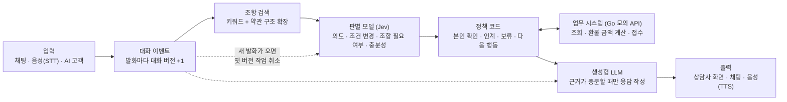
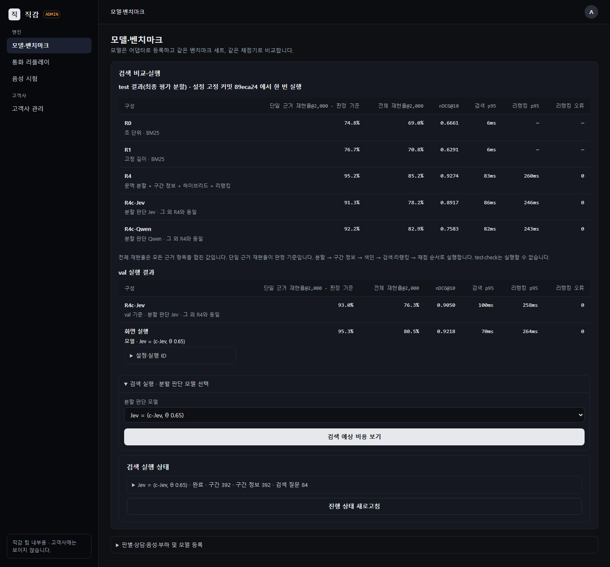

# jikgam (직감)

한국어 고객 상담에서 고객의 말이 바뀔 때마다 근거를 빠르게 다시 고르는 상담 엔진과, 그 효과를 잰 실험 기록이다.

이름은 판별 모델이 하는 일, 즉 맥락을 보고 몇 초 안에 내리는 직관적 판단에서 따왔다.

처음이라면 [전체 흐름 안내](docs/overview.md)와 [용어집](docs/glossary.md)을 먼저 보면 된다.

## 무엇을 하는 시스템인가

상담 중에는 고객의 말이 계속 바뀐다. "해지할게요"가 "아니, 이번 달 환불만요"로 바뀌고 결제일을 잘못 말했다가 고친다. 말이 바뀌면 적용할 약관 조항과 안내도 바뀌어야 한다.

이 엔진은 고객이 말할 때마다 다음을 판단한다.

- 무엇이 바뀌었는가
- 어떤 약관 조항이 지금 필요한가
- 지금 확정해서 답할 수 있는가

근거가 충분할 때만 생성형 LLM으로 답을 만든다. 부족하면 확인 질문을 하거나 확답을 보류한다. 채팅, 음성, AI가 연기하는 고객 시험이 모두 같은 엔진을 쓴다.

## 왜 이렇게 만들었나

질문 하나에 검색 한 번, 생성 한 번을 하는 흔한 RAG 구조는 대화가 계속 바뀌는 상담에 맞지 않는다. 일반 규정, 예외, 부칙이 함께 걸리는 질문에서도 오류가 많다.

**생성형 LLM으로 매번 판단하면 느리고 비싸다.** 판단 한 번에 몇 초가 걸리면 판단을 덜 자주 하게 된다. 그 사이 고객이 조건을 바꾸면, 이미 틀린 안내가 상담사 화면에 남거나 고객에게 나간다.

**그래서 판단과 생성을 나눴다.**

- **판단:** "예/아니오", "이 중 하나" 같은 작은 판단은 판별 모델이 맡는다. 판별 모델은 정해진 형식의 질문에 확률로만 답하고 문장을 쓰지 않는 모델로, 예를 들면 Jev다. 빠르고 싸므로 고객이 말할 때마다 판단할 수 있다.
- **생성:** 고객에게 할 말은 생성형 LLM이 만든다. 근거가 충분하다고 판단된 순간에만 부른다.
- **계산:** 날짜 비교, 환불 금액 계산, 본인 확인처럼 틀리면 안 되는 일은 AI가 아니라 코드와 업무 시스템이 한다.

**고객이 말할 때마다 대화에 버전 번호를 붙인다.** 진행 중이던 판단이나 응답 생성이 옛 버전 기준이면 취소하거나 버린다. 이 장치가 "이미 틀린 안내가 나가는 것"을 막는다.

## 시스템 구조



- 판별 모델은 질문 여러 개를 한 번의 요청으로 병렬로 판단한다.
- 판별 모델은 공통 인터페이스 뒤에 있다. Jev, Cloudflare Clef, 직접 학습한 모델을 설정만 바꿔 교체한다.
- 회사(조직)마다 다른 약관, 업무 시스템 형식, 규칙 값은 설정 파일과 변환 장치(어댑터)로만 표현한다.

## 결과 요약 (2026-10-14)

평가 기준과 성공 기준은 측정 전에 [평가 기준 문서](docs/evaluation.md)에 고정했다. 설정을 고정한 뒤, 개발 중에 한 번도 쓰지 않은 데이터로 한 번씩 평가했다. 독립 검토자가 모든 수치를 원본 로그로 다시 계산해 대조했다.

모든 데이터는 가상이다. 아래는 합성 대화와 합성 판별 데이터로 잰 결과이며 실제 운영 성과가 아니다.

### 1. 판별 모델은 생성형 LLM만큼 정확하면서 빠르고 싼가

최종 시험용 판별 데이터(test, 판단 146개)로 쟀다. 질문 문구는 `q-2026.10.14-mix`이고 서울에서 측정했다.

| 판별 방식 | 정확도 | p95 지연 | 요청당 비용 |
|---|---|---|---|
| Jev `jev-1.13.0` | 86.6% (반복 실행별 126~127개) | 233ms | $0.000116 |
| gemini-3.8-flash(생성형 LLM으로 판단, 사고 토큰 0) | 89.0% (128~131개) | 5,135ms | $0.002964 |

- p95 지연은 요청 100개 중 느린 쪽 5개를 뺀 최대 지연이다.
- 정확도 차이 2.47%p는 미리 정한 기준(3%p 이내) 안이지만 기준선에 가깝다.
- 지연은 약 1/22, 비용은 약 1/26이다.

### 2. 고객이 조건을 바꿨을 때 근거를 빨리 다시 고르고, 틀린 안내를 막는가

미공개 평가 시나리오 20개를 3회씩, 채팅으로 돌렸다. 미공개 평가 시나리오는 엔진 개발에 참여하지 않은 별도 작성자가 쓰고 개발 중에는 아무도 열어 보지 않은 시나리오다. AI가 고객을 연기하고 다른 AI와 코드가 상담 결과를 채점한다.

| 비교한 방식 | 조건 변경 후 근거를 다시 고르기까지(p95) | 이미 틀린 안내가 나간 횟수 | 시나리오 통과 |
|---|---|---|---|
| 개선형 RAG 챗봇(검색은 엔진과 같음, 판별 모델·대화 버전 없음) | 17,059ms | 23 / 72 | 25 / 50 |
| 같은 엔진 + 생성형 LLM으로 판단 | 5,939ms | 0 / 65 | 39 / 55 |
| 같은 엔진 + Jev | 245ms | 0 / 64 | 36 / 51 |

- 문서와 실행기 옵션에서는 위에서부터 정책 A, B, C라고 부른다.
- "이미 틀린 안내"는 고객이 조건을 바꾼 뒤에도 바꾸기 전 정보로 만든 안내가 화면에 뜨거나 고객에게 나간 경우다. 분모는 조건 변경 뒤에 나간 안내의 수다.
- 틀린 안내가 줄어든 것은 엔진 구조(대화 버전과 진행 중 작업 취소) 덕분이다. 근거를 다시 고르는 시간이 줄어든 것은 판별 모델의 속도 덕분이다. 표에서 엔진이 같은 두 줄(생성형 LLM 판단과 Jev)을 비교하면 이 둘을 나눠 볼 수 있다.

### 3. 한국어로 학습시킨 판별 모델은 쓸 만한가

Qwen3.5-2B를 Unsloth로 이 PC의 RTX 3090 Ti에서 학습시켰다.

| 판별 방식 | test 정확도 | p95 지연 |
|---|---|---|
| 학습한 2B(train + 보강 사례 + 공개 영어 판별 데이터 typed-decisions) | 87.0% (127개) | 165ms(로컬 연속 호출) |
| Clef-flash(한국어 학습 전 공개 판별 모델) | 72.6% (106개) | 890ms(Cloudflare Workers AI) |
| Jev | 86.6% | 233ms |

실패 유형 13개 중 12개에서 Clef-flash보다 나아졌다.

## 음성 결과 (2026-10-15)

위 2번 질문을 음성 통화로 다시 쟀다. 음성은 세 가지가 다르다. 한 번 나간 말은 되돌릴 수 없고, 음성 인식과 합성 시간이 더해지며, 고객이 답을 듣다가 끼어든다. 기준은 음성으로 돌리기 전에 [음성 평가 기준](docs/evaluation-voice.md)에 정해 고정했다. 위 채팅 결과 표는 바꾸지 않는다.

같은 미공개 평가 시나리오 20개를 3회씩 돌렸다. AI 고객의 말을 TTS로 읽혀 실시간으로 넣었고, 엔진의 답은 TTS로 재생했다. 합성 음성으로 잰 결과이며 실제 통화 성과가 아니다.

| 비교한 방식 | 조건 변경 후 근거를 다시 고르기까지(p95) | 이미 틀린 안내가 소리로 나간 횟수 | 시나리오 통과 |
|---|---|---|---|
| 개선형 RAG 챗봇(정책 A) | 18,635ms | 19 / 62 | 22 / 52 |
| 같은 엔진 + Jev, 확정 자막으로 판단(정책 C) | 1,231ms | 0 / 72 | 38 / 57 |
| 정책 C + 실시간 자막으로 미리 판단(정책 D) | 1,129ms | 0 / 74 | 39 / 54 |

- 정책 D는 고객이 말하는 도중 실시간 자막으로 판별을 미리 돌려 둔다. 말이 끝나면 확정 자막을 기다리지 않고 바로 판단을 이어 간다([결정 기록 0018](docs/adr/0018-음성-정책-D.md)).
- 이미 틀린 안내와 업무 성공은 C와 D 모두 미리 정한 기준을 만족했다. A의 틀린 안내 19건은 모두 끝까지 재생됐다(한 건에 중앙값 25.2초).
- 근거 갱신은 A의 1/10 이하였지만, 채팅 기준을 그대로 쓴 "500ms 이하"는 C와 D 모두 넘지 못했다. 음성은 말이 0.5초 멈춰야 끝난 것으로 보므로, 그 시간이 늘 들어간다. C는 확정 자막도 기다린다(발화 끝에서 중앙값 815ms).
- 그래서 주장 2는 음성에서 일부만 성립했다([결정 기록 0020](docs/adr/0020-음성-평가-결과와-이후-결정.md)).
- D는 C보다 근거 갱신이 약 0.1초 빨랐지만 판별 호출이 4.7배였다. 잠정 판단의 42.5%(313건 중 133건)는 확정 자막과 달라 다시 판단했다. D에서는 확정 자막을 짝짓는 결함도 찾았다. 음성 기본 방식은 C로 둔다.
- 고객이 듣는 첫 응답까지는 C·D 모두 약 4.6~4.9초였고, 대부분 답 생성과 TTS 시간이다.

## 웹 콘솔 (2026-10-15)

웹 화면은 두 제품으로 나뉜다([결정 기록 0021](docs/adr/0021-웹-콘솔-분리.md)).

- **고객사 콘솔:** 상담 운영팀이 쓰는 화면이다. 실시간 통화, 통화 기록과 녹음 다시 듣기, 운영 리포트, 지식·정책, 연동이 있다. 엔진 용어와 수치는 넣지 않는다.
- **관리 콘솔:** 직감 팀이 쓰는 화면이다. 모델·벤치마크, 통화 리플레이(판단마다 조항 순위와 무효가 된 답을 따라감), 고객사 관리가 있다.

화면 수치는 모두 결과 폴더의 원본 로그에서 화면을 열 때 계산한다. 자료는 합성 상담이다.

화면을 만들기 전에 디자인 하네스를 먼저 만들었다([결정 기록 0022](docs/adr/0022-디자인-하네스.md), [안내](docs/design/README.md)). 하네스는 다음을 검사한다.

- 토큰 밖 색·px 금지
- 공용 컴포넌트만 쓰기
- 고객사 화면 금지어
- 숫자 출처
- 1440·390px 스크린샷
- axe와 키보드
- 화면별 독립 리뷰


## 큰 문서 검색 결과 (v2, 2026-10-18)

v1 약관은 23개 구간이었다. v2는 실제 공개 문서 10개(법령, 고시, 공정위 표준약관)에서 검색을 다시 쟀다. 문서 분량은 공백을 빼고 247,824자로 v1의 약 53배다.
- 기준은 측정 전에 [v2 평가 기준](docs/evaluation-v2.md)에 고정했다.
- 설정을 고정한 커밋에서 test를 한 번 돌렸다([결정 기록 0026](docs/adr/0026-v2-test-결과와-이후-결정.md)).
- 질문과 정답은 AI가 만든 합성 자료다.
- 독립 검토자가 판정 수치를 원본 기록에서 다시 계산해 대조했다.

| 방식 | 근거 재현율@2,000 | 검색 p95 | 리랭킹 p95 |
|---|---|---|---|
| R0 v1 방식(조 단위 + BM25) | 74.8% | 5.9ms | - |
| R1 고정 길이 + BM25 | 76.7% | 6.0ms | - |
| R4 문맥 분할 + 구간 정보 + 하이브리드 + Jev 리랭킹 | 95.2% | 83ms | 260ms |

- **근거 재현율@2,000:** 검색 결과를 순서대로 2,000토큰까지 넣었을 때 정답 근거 글을 덮는 비율이다. test의 단일 근거 질문 103개로 쟀다.
- **검색 병목:** v1 방식은 큰 문서에서 정답 근거를 네 번에 한 번꼴로 놓쳤다. 미리 정한 기준(80%)에 따라 "검색이 정확도 병목"으로 판정했다.
- **R4 대 R0:** 재현율은 R0보다 20.4%p 높았다(95% 구간 11.7~29.1). 같은 질문에 대한 답변 정답률도 80.6%에서 96.1%가 됐다. 하지만 리랭킹 p95가 미리 정한 250ms를 넘어 "낫다"로 판정하지 않았다.
- **경계 판단 교체:** 문맥 경계 판단을 생성형 LLM(gemini-3.8-flash)에서 판별 모델로 바꾸는 것은 기준을 넘지 못했다.
  - Jev는 재현율이 3.9%p 떨어졌다.
  - 학습한 2B는 분할 시간이 2.2배였다.
- **엔드투엔드:** 상담 시나리오로 재는 엔드투엔드는 아직 하지 않았다.



## 한계

- 모두 가상 회사, 가상 고객, AI가 만든 대화로 잰 결과다.
- **1번 결과:** 정확도 차이가 기준선에 가깝다. 대화 단위 부트스트랩 95% 구간은 [−9.7, +4.6]%p다. gemini-flash를 영어 질문 문구로 돌리면(90.9%) 차이가 4.29%p로 기준을 넘는다.
- **2번 결과:** 채팅에서만 쟀다. 음성에서 확정 전 자막으로 먼저 판단하는 방식은 아직 측정하지 않았다.
  - 2026-10-15에 음성으로 쟀다(위 '음성 결과').
- **음성 결과:** 합성 음성(고객 목소리 하나, 잡음 없음)과 AI 고객으로 잰 결과다. 고객 AI는 답을 끝까지 듣고 말해서, 틀린 안내를 고객이 끊는 경우가 없었다. TTS 오류 뒤 늦게 나온 음성 3건이 로그에 남지 않은 결함이 있다. 판정은 바뀌지 않는다.
- **3번 결과:** 엔진처럼 다른 호출 사이에 띄엄띄엄 부르면 p95가 447~479ms로 늘어난다. 그래서 엔진 기본값은 Jev로 두었다([결정 기록 0015](docs/adr/0015-최종-평가-결과와-이후-결정.md)).
- **v2 결과:** 질문과 정답은 AI가 만들었고, 사람 검토에서 단일 근거 질문의 24%에 문제가 있었다. 답변은 한 번만 만들었다. 근거 없는 주장은 두 방식 모두 0건이라 차이를 가르지 못했다. 엔드투엔드는 재지 않았다.
- test 정답은 AI가 쓰고 AI가 검토했다. 사용자가 20건 중 14건에 동의했고 6건에는 의견을 냈다([라벨 검토 기록](docs/labeling-review.md)).

## 실행 방법

```sh
uv sync                                   # Python 3.12 환경
uv run pytest                             # 단위 테스트
cd bizapi && go run ./cmd/bizapi          # 조직 A 모의 업무 API (127.0.0.1:8081)
uv run python -m jikgam.eval.run_decisions --split val --backends jev,gemini-flash   # 판별 평가(.env에 API 키 필요)
uv run python -m jikgam.eval.report results/decisions/val/<run_id>                  # 원본 로그로 표 생성
uv run python -m jikgam.sim.runner --org org_a --scenarios all --policy C           # AI 고객 시나리오 실행(모의 업무 API와 .env 키 필요)
uv run python -m jikgam.sim.report results/engine/scenarios/<run_id>               # 시나리오 판정, 근거 갱신 시간, 무효 노출, 비용
uv run python -m jikgam.web                                                         # 웹 콘솔: /app(고객사), /admin(관리) (127.0.0.1:8100)
uv run python scripts/ui_check.py                                                   # 디자인 하네스의 브라우저 검사와 스크린샷
uv run python -m jikgam.voice.replay --replays s01 s20 s21 --bizapi-url http://127.0.0.1:8096  # 음성 재생(실제 STT·TTS, docs/voice.md)
```

시나리오 실행기의 `--policy`는 비교할 방식이다. A는 개선형 RAG 챗봇, B는 엔진 + 생성형 LLM 판단, C는 엔진 + 판별 모델(Jev)이다.

## 더 읽을 문서

| 문서 | 내용 |
|---|---|
| [docs/overview.md](docs/overview.md) | 전체 흐름을 쉬운 말로: 무엇을 만들고 어떻게 쟀는지 |
| [docs/glossary.md](docs/glossary.md) | 용어집: 문서에 나오는 내부 용어 |
| [docs/design.md](docs/design.md) | 문제, 가설, 시스템 설계, 실험 원칙 |
| [docs/engine.md](docs/engine.md) | 상담 엔진의 구현 설계: 이벤트, 대화 버전, 처리 순서 |
| [docs/evaluation.md](docs/evaluation.md) | 측정 전에 고정한 평가 기준과 성공 기준(고치지 않는 문서) |
| [docs/training.md](docs/training.md) | 한국어 판별 모델 학습과 재현 방법 |
| [docs/voice.md](docs/voice.md) | 음성 연결(Pipecat, Gemini STT·TTS) |
| [docs/evaluation-voice.md](docs/evaluation-voice.md) | 음성으로 돌리기 전에 고정한 음성 평가 기준(고치지 않는 문서) |
| [docs/evaluation-v2.md](docs/evaluation-v2.md) | 큰 문서 검색(v2)을 재기 전에 고정한 평가 기준(고치지 않는 문서) |
| [docs/design/](docs/design/README.md) | 웹 콘솔 두 개와 디자인 하네스, 화면 수치의 정의, 독립 리뷰 기록 |
| [docs/org-b.md](docs/org-b.md) | 두 번째 가상 회사를 설정과 어댑터만으로 붙인 기록 |
| [docs/data-format.md](docs/data-format.md) | 판별 데이터 형식과 정답(라벨) 기준 |
| [docs/adr/](docs/adr/README.md) | 결정 기록(ADR): 무엇을 왜 정했는지 |
| [PROGRESS.md](PROGRESS.md) | 날짜별 진행 기록 |
| [docs/overview.md의 저장소 구성](docs/overview.md#7-저장소-구성) | 폴더별 내용 |
