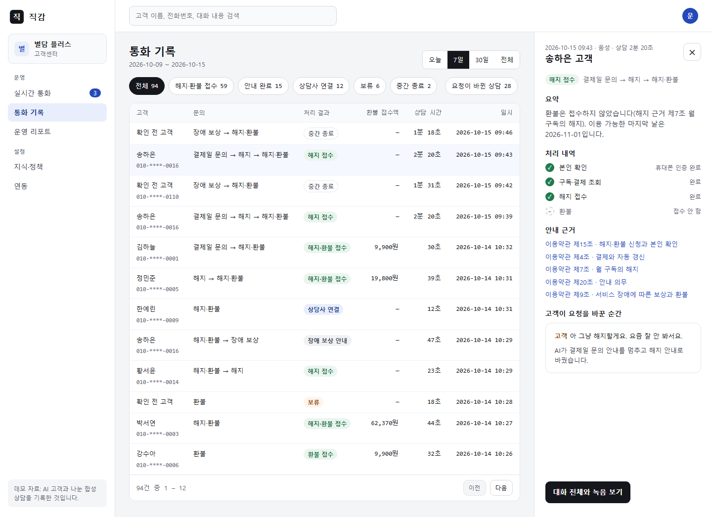
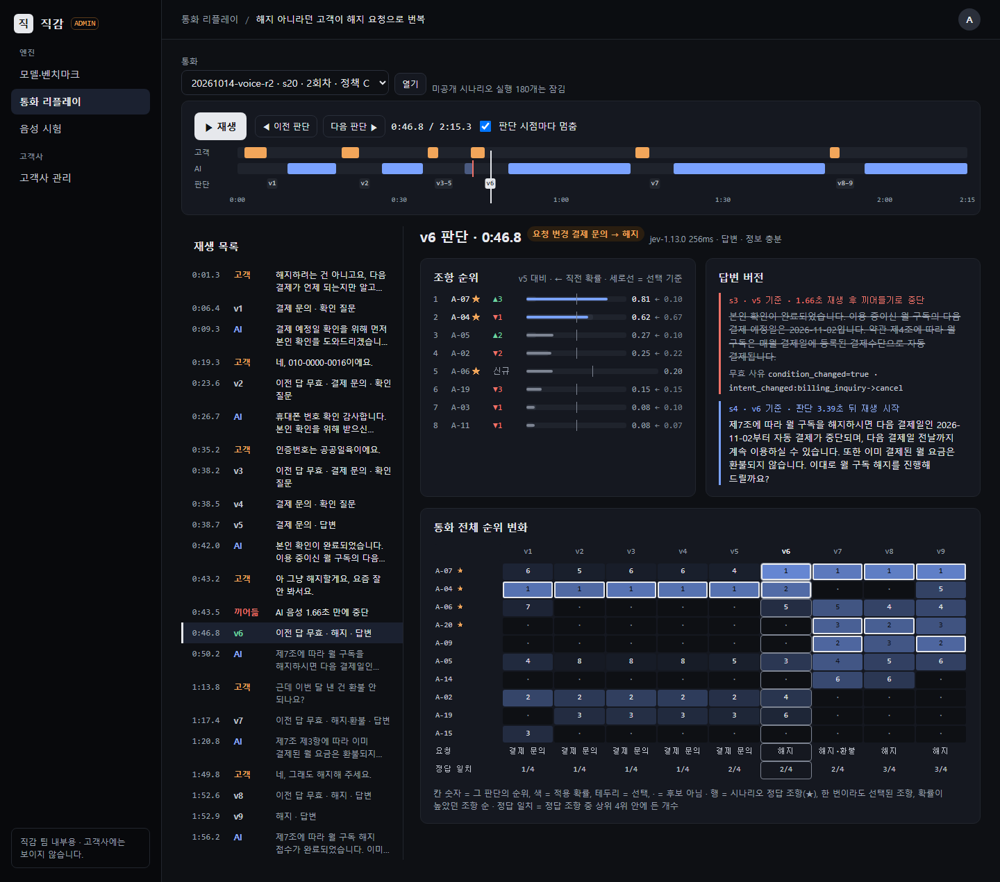
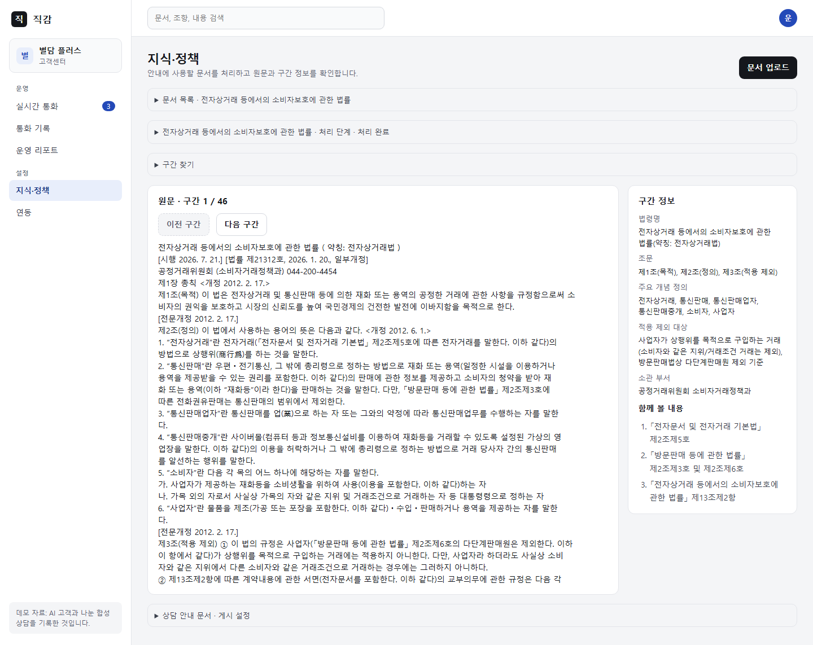

# jikgam (직감)

한국어 고객 상담에서 고객의 말이 바뀔 때마다 근거를 빠르게 다시 고르는 상담 엔진이다. 그 효과를 측정 전에 정한 기준으로 잰 실험 기록도 함께 있다.

모든 데이터는 가상 회사와 합성 대화다. 아래 수치는 실제 운영 성과가 아니다. 처음이라면 [전체 흐름 안내](docs/overview.md)와 [용어집](docs/glossary.md)부터 보면 된다.

## 무엇을 만들었나

- **상담 엔진:** 고객이 말할 때마다 세 가지를 판단한다.
  - 무엇이 바뀌었는가
  - 어떤 약관 조항이 필요한가
  - 지금 답해도 되는가

  작은 판단은 판별 모델(Jev)이 확률로 내린다. 고객에게 할 말은 근거가 충분할 때만 생성형 LLM이 만든다. 발화마다 대화 버전을 올리고, 옛 버전으로 하던 판단과 생성은 버린다([설계](docs/design.md), [엔진](docs/engine.md)).
- **업무 시스템:** 환불 금액, 날짜, 본인 확인은 코드와 Go로 만든 모의 업무 API가 계산한다(`bizapi/`).
- **채널:** 채팅, 음성(Pipecat, Gemini STT·TTS), AI가 연기하는 고객이 모두 같은 엔진을 쓴다.
- **판별 모델 학습:** 한국어 판별 모델(Qwen3.5-2B)을 직접 학습시켰다([학습 기록](docs/training.md)).
- **실제 규모 문서 처리(v2):** 공개 법령·고시·표준약관 PDF를 다음 순서로 처리하는 경로다.
  1. 글 추출
  2. 문맥 단위 분할
  3. 구간 정보
  4. 하이브리드 검색과 리랭킹
- **웹 콘솔 두 개:** 디자인 하네스(금지어, 숫자 출처, 스크린샷, 접근성, 독립 리뷰)를 통과한 화면이다([디자인](docs/design/README.md)).
  - 고객사 콘솔: 통화 기록, 운영 리포트, 지식·정책
  - 관리 콘솔: 모델·벤치마크, 통화 리플레이

## 핵심 결과

기준은 측정 전에 문서로 고정했다. 설정을 고정한 커밋에서 개발에 쓰지 않은 자료로 한 번씩 쟀고, 측정과 분리된 검토자가 원본 기록으로 다시 계산해 대조했다.

| 확인한 것 | 결과 | 판정 | 기록 |
|---|---|---|---|
| 판별 모델이 생성형 LLM 판단만큼 정확하면서 빠르고 싼가 | Jev 대 gemini-3.8-flash: 정확도 86.6% 대 89.0%(차이 2.47%p, 기준 3%p 이내), p95 233ms 대 5,135ms, 요청당 $0.000116 대 $0.002964 | 성립 | [ADR 0015](docs/adr/0015-최종-평가-결과와-이후-결정.md) |
| 고객이 조건을 바꿀 때 근거를 빨리 다시 고르고 틀린 안내를 막는가(채팅) | 엔진 + Jev: 근거 갱신 p95 245ms, 틀린 안내 0/64. 개선형 RAG 챗봇: 17,059ms, 23/72 | 성립 | [ADR 0015](docs/adr/0015-최종-평가-결과와-이후-결정.md) |
| 한국어로 학습한 2B 판별 모델 | test 정확도 87.0%(Jev 86.6%), 로컬 연속 호출 p95 165ms | 성립 | [ADR 0015](docs/adr/0015-최종-평가-결과와-이후-결정.md) |
| 같은 질문을 음성 통화로 | 틀린 안내 0/72(RAG 챗봇 19/62). 근거 갱신 p95 1,231ms로 500ms 기준 미달 | 일부 성립 | [ADR 0020](docs/adr/0020-음성-평가-결과와-이후-결정.md) |
| 실제 규모 문서에서 검색 | v1 방식 근거 재현율 74.8%(병목). 새 방식 95.2%(+20.4%p)지만 리랭킹 p95 260ms로 기준 250ms 초과 | "낫다" 아님 | [ADR 0026](docs/adr/0026-v2-test-결과와-이후-결정.md) |
| 새 검색을 상담 엔진에 넣었을 때(엔드투엔드) | 시나리오 통과 R4 0/30, R0 5/31(−16.1%p). 근거 없는 주장과 근거 갱신 기준은 만족 | 비열등 불만족 | [ADR 0028](docs/adr/0028-v2-엔드투엔드-결과.md) |

## 화면







## 안 된 것

- **음성 근거 갱신:** 음성에서는 근거 갱신이 500ms 안에 들지 않았다(정책 C 1,231ms). 말이 0.5초 멈춰야 끝난 것으로 보고, 확정 자막도 기다리기 때문이다([ADR 0020](docs/adr/0020-음성-평가-결과와-이후-결정.md)).
- **실제 규모 문서 검색(v2):** 검색 재현율은 크게 올랐지만 리랭킹 지연 기준을 넘었다. 문맥 경계 판단을 판별 모델로 바꾸는 것도 기준을 넘지 못했다.
  - Jev: 재현율 −3.9%p
  - 학습한 2B: 분할 시간 2.2배
- **v2 엔드투엔드:** 엔진 안에서는 새 검색이 상담 결과를 낫게 하지 못했다. 두 구성 모두 통과율이 낮았고, 실패는 대부분 법령 안내와 법령 근거 항목이었다. 개발용 시나리오에서는 정답 법령 구간이 엔진의 검색 후보 8개에 들지 않는 경우가 많았다.
- **판별 정확도 차이:** 정확도 차이(2.47%p)가 기준선에 가깝다. 대화 단위 95% 구간은 [−9.7, +4.6]%p다.
- **학습한 2B의 지연:** 엔진처럼 다른 호출 사이에 띄엄띄엄 부르면 p95가 447~479ms로 늘어난다. 그래서 엔진 기본값은 Jev로 둔다.
- **데이터:** 질문과 정답은 AI가 만들고 AI가 검토했다.
  - v1 test 정답은 사용자가 20건 중 14건에 동의했다([라벨 검토](docs/labeling-review.md)).
  - v2 단일 근거 질문은 사람 검토에서 24%에 문제가 있었다(`docs/evaluation-v2.md` §8 보완).

## 시연: 웹 콘솔 띄우기

이 PC에서 확인한 순서다.

1. **준비물:** Python 3.12와 [uv](https://docs.astral.sh/uv/), Go. Go는 화면에서 상담 시나리오 벤치마크를 돌릴 때 모의 업무 API를 빌드하는 데 쓴다.
2. **서버 띄우기:** 저장소 루트에서 다음 한 줄을 실행한다. 의존성(문서 처리용 임베딩 포함)을 맞춘 뒤 서버를 띄운다.

   ```sh
   uv run --group embed python -m jikgam.web
   ```

3. **로그인:** 터미널에 이번 실행에만 쓰는 계정(admin, org-a, org-b)과 비밀번호가 출력된다. 고정 계정을 쓰려면 `.env`에 `JIKGAM_WEB_ACCOUNTS`를 둔다(형식은 `jikgam/web/auth.py`).
4. **화면 열기:** 브라우저에서 두 주소를 연다.
   - 고객사 콘솔: http://127.0.0.1:8100/app (org-a 계정)
   - 관리 콘솔: http://127.0.0.1:8100/admin (admin 계정)

화면은 결과 폴더의 기록을 열 때마다 계산하므로, 위 단계만으로 통화 기록, 리포트, 리플레이, 벤치마크를 볼 수 있다. 몇 가지는 따로 준비해야 한다.

- **유료 호출이 드는 기능:** PDF 처리, 검색 벤치마크 실행, 상담 시나리오 실행은 실행 전에 예상 비용을 보여 준다. 실행하려면 `.env`에 API 키가 있어야 한다.
  - Gemini: `GCP_API_KEY`
  - Jev: `TYPESAFE_API_KEY`
- **지식·정책 화면:** 표준약관 두 개의 원문과 구간 정보를 읽는다. 이 자료는 다시 배포해도 되는지 확인하지 못해 저장소 밖(`data/v2/local/`)에 둔다. 새로 받은 저장소에서는 [ADR 0023](docs/adr/0023-v2-원본-문서와-텍스트-추출.md)의 절차(`scripts/v2_fetch_sources.py`)로 받아 처리해야 이 화면이 열린다.
- **학습한 2B로 분할하기:** WSL2에서 판별 서버를 띄워야 선택할 수 있다(`scripts/run_v2_test.sh` 머리말).
- **음성 시험(관리 콘솔 → 음성 시험):** 브라우저 마이크로 직접 말하며 엔진을 시험한다. 다른 터미널에서 모의 업무 API(`cd bizapi && go run ./cmd/bizapi`)를 먼저 띄우고, 이 PC의 브라우저에서 연다. `.env`에 `GCP_API_KEY`(Gemini STT·생성·TTS)와 `TYPESAFE_API_KEY`(Jev)가 있어야 하고 유료 호출이 든다(화면에 분당 예상 비용). 기록은 `results/voice/live/`에 남고 평가 수치에 쓰지 않는다([docs/voice.md §8](docs/voice.md)).

## 그 밖의 실행

```sh
uv sync && uv run pytest                                              # 단위 테스트
cd bizapi && go run ./cmd/bizapi                                      # 조직 A 모의 업무 API(127.0.0.1:8081)
uv run python -m jikgam.sim.runner --org org_a --scenarios all --policy C   # AI 고객 시나리오(.env 키 필요)
uv run python -m jikgam.sim.report results/engine/scenarios/<run_id>         # 판정, 근거 갱신, 무효 노출, 비용
uv run python scripts/ui_check.py                                     # 디자인 하네스 브라우저 검사와 스크린샷
```

`--policy`는 비교할 방식이다.
- A: 개선형 RAG 챗봇
- B: 엔진 + 생성형 LLM 판단
- C: 엔진 + Jev

## 더 읽을 문서

| 문서 | 내용 |
|---|---|
| [docs/overview.md](docs/overview.md) | 전체 흐름을 쉬운 말로: 무엇을 만들고 어떻게 쟀는지, 저장소 구성 |
| [docs/glossary.md](docs/glossary.md) | 용어집 |
| [docs/design.md](docs/design.md) · [docs/engine.md](docs/engine.md) | 문제와 가설, 시스템 설계, 엔진 구현 |
| [docs/evaluation.md](docs/evaluation.md) · [docs/evaluation-voice.md](docs/evaluation-voice.md) · [docs/evaluation-v2.md](docs/evaluation-v2.md) | 측정 전에 고정한 평가 기준(채팅, 음성, 큰 문서 검색) |
| [docs/training.md](docs/training.md) | 한국어 판별 모델 학습과 재현 |
| [docs/voice.md](docs/voice.md) | 음성 연결 |
| [docs/design/](docs/design/README.md) | 웹 콘솔, 디자인 하네스, 화면 수치 정의, 독립 리뷰 기록 |
| [docs/org-b.md](docs/org-b.md) | 두 번째 가상 회사를 설정과 어댑터만으로 붙인 기록 |
| [docs/adr/](docs/adr/README.md) | 결정 기록: 무엇을 왜 정했는지, 결과 판정 |
| [PROGRESS.md](PROGRESS.md) | 날짜별 진행 기록 |
